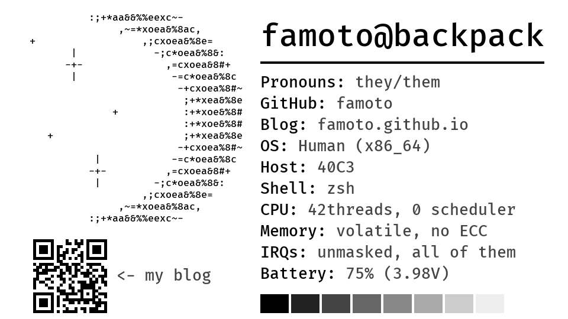

# Fastfetch con nametag (LilyGO T5 4.7" E-Paper S3 V2.3)

A battery-powered e-paper con badge that looks like `fastfetch` output: an ASCII logo,
`user@host`, key/value rows, battery level, a QR code, and a grayscale bar.



It draws the whole badge on power-on or **RST**, then deep-sleeps. The **IO21** button or a
timer (60 minutes by default) wakes it, and only the views that changed are redrawn. With the
default content, that's just the battery row. E-paper keeps the image without power.

## Quick start

1. Edit `BADGE` in `firmware/src/config.rs` (user, host, rows, QR URL, logo).
2. Preview it without hardware: `cd preview && cargo run --locked` writes `preview.png`.
3. Flash it (details and toolchain pins in [docs/firmware.md](docs/firmware.md)):

   ```sh
   cargo install espup espflash
   espup install --targets esp32s3 --toolchain-version 1.95.0.0
   . ~/export-esp.sh
   cd firmware && cargo run --release        # builds, flashes, opens monitor
   ```

## Repository layout

```
firmware/   Rust (no_std, esp-hal) badge firmware; settings in src/config.rs
preview/    Desktop preview (PNG) and host test crate sharing the firmware modules
tools/      fontgen.py (Fira Code -> e-paper fonts), moon.py (the ASCII moon)
case/       nametag_case.scad + tray.stl + bezel.stl
docs/       Detailed documentation (below)
```

## Documentation

| Topic | Contents |
|---|---|
| [Firmware](docs/firmware.md) | Toolchain and flashing, wake/refresh behavior, button handling, board revisions |
| [Configuration](docs/configuration.md) | Badge content, layout, refresh settings, fonts and logo |
| [Architecture](docs/architecture.md) | Wake-cycle flow, source layers, view IDs, power notes |
| [Testing](docs/testing.md) | Host tests and the on-hardware checklist |
| [Case and parts](docs/case.md) | 3D-printed case, assembly, parts list |

The UI library API (view registry, refresh requests, update guarantees) is documented in
`firmware/src/ui/mod.rs`.
