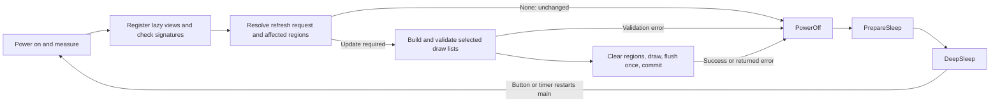

# Fastfetch con nametag (LilyGO T5 4.7" E-Paper S3 V2.3)

```
nametag/
  firmware/            Rust (no_std, esp-hal) — badge settings live in src/config.rs
  preview/             Desktop preview and host test crate
    src/               Shared firmware imports, framebuffer, and PNG entry point
    tests/             controller.rs, refresh.rs, rendering.rs, scoped_refresh.rs
  tools/               fontgen.py (Fira Code -> e-paper font files), moon.py (the ASCII moon)
  case/                nametag_case.scad + tray.stl + bezel.stl
```

## Firmware

Driver: [`lilygo-epd47`](https://crates.io/crates/lilygo-epd47) 1.1 (esp-hal port of LilyGO's ED047TC1 driver, V2.3/S3 only, GPL-3.0).
Draws the whole badge on power-on or **RST**, then deep-sleeps until the **IO21** user button
is pressed or the configured interval elapses (currently 60 minutes). Button/timer wakes
update only changed registered views. With the default static content, only the battery changes.
If all displayed content is unchanged, the firmware skips clearing/drawing/flushing.
E-paper keeps the image unpowered.

The registered views' bounds, content signatures, and partial refresh count are retained
in RTC fast RAM with a version marker and checksum; no flash writes are needed. Cold boot,
RST, invalid retained state, or a failed panel update forces a full redraw. Moving, resizing,
registering, or deregistering a view uses partial updates, including erasing its old location.
`FULL_REFRESH_AFTER_PARTIALS` in `firmware/src/config.rs` defaults to `Some(24)`: the wake after
24 successful partial updates performs a full cleanup, even if content is unchanged.
An update of several views counts once. Set it to `None` to disable
automatic cleanup, or `Some(0)` to always redraw fully. Adjust this after checking ghosting
on your panel. Unchanged content does not count toward the cleanup threshold.

Set `REFRESH_INTERVAL_MINUTES` in `firmware/src/config.rs` to `Some(360)` for six hours,
`Some(30)` for thirty minutes, or `None` for button-only refresh. The minute count must be nonzero.
Set `BUTTON_WAKE_ENABLED` in `firmware/src/config.rs` to `false` for timer-only operation. Disabling both restores
reset-only operation. The interval starts when entering sleep after each refresh; it is not
a wall-clock schedule and needs neither Wi-Fi nor the external PCF8563 RTC.

Before sleeping, the firmware waits up to two seconds for a debounced button release.
If IO21 is still held, it sleeps with wake-on-release instead of wake-on-press, avoiding
repeated immediate wakes. Releasing then checks the battery again and restores normal
press-to-refresh behavior. The scheduled timer remains enabled during a long press.
IO0 remains reserved for boot/panel control.

The supplied pinmap picture labels its PCB **V2.4 capacitive touch**. IO21/button and
IO14/battery agree with this implementation, but the driver targets V2.3; display compatibility
with V2.4 still requires a hardware check. Touch wake and the external RTC are not configured.

Edit `BADGE` in `firmware/src/config.rs` to change the user, host, information rows,
QR URL/caption, logo, or colour scale values. `BadgeConfig<'a>` also accepts strings and
rows borrowed from runtime buffers; these buffers must live through the wake cycle.
`LAYOUT` uses the same small `ViewLayout` for each view's bounds and anchor, with named settings
for spacing, QR module size, and grayscale ink. View bounds use panel coordinates;
all element positions, including text origins and the QR bottom, are relative to their view.
Then run `cd preview && cargo run --locked` to see the result without flashing.
The preview uses the same configuration, fonts, and renderer as the firmware; its simulated battery
voltage and output path are constants at the top of `preview/src/main.rs`.

`src/main.rs` initializes hardware and PSRAM, runs one wake cycle through `src/app.rs`,
logs any returned error after panel shutdown, then enters deep sleep through `src/power.rs`.
Each wake runs the same sequence:



The layers have separate responsibilities:

| Layer | File | Responsibility |
|---|---|---|
| App | `src/app.rs` | Measure, build the default scene, refresh, and always shut down before returning |
| Scene | `src/badge.rs` | Six named builders register independent lazy view recipes |
| UI pipeline | `src/ui/mod.rs` | Track edits and own the plan/validate/clear/draw/flush/commit transaction |
| Views | `src/ui/view.rs` | Eager/lazy content, visual signatures, styles, bounds, and stable IDs |
| Renderer | `src/ui/render.rs` | Validate and draw elements against the target's bounds |
| Refresh | `src/ui/refresh.rs` | Diff snapshots, expand affected regions, and check retained records |
| Hardware | `src/hardware.rs` | Own the panel, ADC, and button; provide display, power, and RTC-memory operations |
| Power | `src/power.rs` | Debounce the button, configure wake sources, retain RTC RAM, and enter deep sleep |

A `Pipeline` owns a bounded registry of views. Each `View` has panel bounds and either an eager
draw list or a lazy recipe for text, filled rectangles, and QR elements. Element positions are relative to the view,
so changing `view.area.top_left` moves all its content. Text can borrow static strings
or own runtime strings. The renderer has no dependency on badge content or layout.

`register(id, view)` adds or replaces a view; `get_mut(id)` returns an edit guard for its content or bounds;
`deregister(id)` removes it. IDs are stable slots from 0 through `MAX_VIEWS - 1` (currently 16).
Higher IDs render on top. Registration and removal update cached signatures and queue changes.
Dropping an edit guard does the same for that view; mutate elements through `content_mut()` or
replace the list with `set_content(...)`. `content()` provides read access and materializes lazy
content when needed. The panel is updated when `pipeline.refresh(...)` is called.

The default scene is built by `badge::frame(&badge, &layout, volts)?`, which rejects
information row spacing smaller than the text height:

| View ID | Content |
|---|---|
| `badge::LOGO` (0) | ASCII art |
| `badge::HEADLINE` (1) | `user@host` and underline |
| `badge::DATA` (2) | Ordered key/value rows |
| `badge::BATTERY` (3) | Battery label, percentage, and voltage |
| `badge::BONUS` (4) | QR code and caption |
| `badge::COLOUR_SCALE` (5) | Grayscale blocks |

The returned pipeline borrows the content buffers, so the `BadgeConfig` wrapper can be
local to a factory function.
Other scenes can start with `Pipeline::new()` and register any combination of views.
Views are not tied to these six IDs or to particular content types.

For example, after powering the panel and sampling the battery, replace the data view
with a lazy runtime view and later remove it:

```rust
use embedded_graphics::geometry::Point;
use crate::ui::{Font, RefreshRequest, View};

let mut pipeline = badge::frame(&config::BADGE, &config::LAYOUT, volts)?;
let area = pipeline.get(badge::DATA).unwrap().area;
pipeline.register(badge::DATA, View::lazy(area, move |elements| {
    elements.line(Point::new(0, 8), format_args!("Status: {status}"), Font::Text, 0);
}))?;
pipeline.refresh(&mut board, RefreshRequest::Changed, resume, config::FULL_REFRESH_AFTER_PARTIALS)?;

pipeline.deregister(badge::DATA)?;
pipeline.refresh(&mut board, RefreshRequest::Changed, true, config::FULL_REFRESH_AFTER_PARTIALS)?;
```

`View::lazy(area, recipe)` visits the same deterministic element recipe to compute a visual
signature and, only when selected, construct its draw list. Use `elements.push(Element::...)`
for existing content and `elements.line(..., format_args!(...), ...)` for formatted text.
Formatting streams into the signature without allocating a temporary string; the string is
allocated when drawing needs it. A recipe must emit identical elements on every visit.
Capture immutable inputs and replace/edit the registered view when those inputs change.
`View::new(area, elements)` remains available for eager draw lists.

All views use the same refresh path. The registry caches bounds and 64-bit content signatures;
awake edits rehash only the edited view. A fresh wake checks the lazy descriptions against RTC
records before materializing any draw lists. Unchanged scenes skip draw-list construction,
validation, clearing, rendering, and flushing, even when inputs use different allocations.
Text signatures account for the font's unsupported-character fallback; QR URLs retain UTF-8.

`Pipeline::refresh(backend, request, resume, full_after)` accepts:

| Request | Behavior |
|---|---|
| `RefreshRequest::Changed` | Process queued changes; return early when nothing needs updating |
| `RefreshRequest::Views(mask)` | Force redraw of selected IDs, e.g. `1 << badge::BATTERY` |
| `RefreshRequest::Region(rect)` | Invalidate any rectangle inside the draw target, including empty background |
| `RefreshRequest::Full` | Force a complete framebuffer/panel clear and redraw |

Regions expand to complete affected views, including overlaps and old locations. They are not
pixel clipping boundaries. Zero-sized regions and empty masks do nothing when no full recovery
or cleanup is due; out-of-bounds regions fail before any panel writes. Cold boot, reset, invalid
retained state, and periodic cleanup override valid scoped requests with a full redraw.
Scoped updates commit only the records actually presented; unrelated changes remain pending
for a subsequent refresh. A background-only region still clears, flushes, and counts as one partial update.

Partial updates erase old bounds for changed or removed views and the current bounds of
views needing redraw. Clearing can affect overlapping views, so the planner expands the
selection until all affected layers are included. It redraws them in ID order and flushes
once. Duplicate and fully contained clear rectangles are omitted. Removed views need no
draw call, but their erased regions still require a successful update before committing state.

`Pipeline::draw(target, views)` renders directly; `views` is a native `u16` mask (all: `u16::MAX`,
one view: `1 << id`). The complete selection is prepared and validated before physical clears or
pixel writes. Preparation produces draw commands and encodes each QR once for that update. View bounds
must be nonempty and inside the draw target; all elements must fit their view. Overlapping views
are supported. `Element::text` supports multiline text, while `Element::line` rejects newlines.
The default data view fits nine rows at roughly 32 characters including `Key: `.

`Pipeline::refresh` in `src/ui/mod.rs` owns the shared transaction. Its `Backend` interface
provides a draw target, retained storage, region/full clear, and flush; hardware adapters contain
no scene selection or rendering policy. Validation errors leave the displayed image and saved
records intact. The pipeline invalidates retained state before changing the panel and commits
new records only after a successful flush. Full recovery also resets buffered pixels left by
failed awake updates. `app::run` measures once, builds the static badge registry, calls this
method, and powers off before returning, including on errors.
For a future awake loop, keep the registry and call `refresh` after changing views; the caller
owns timing, power-on, and shutdown, including on errors.

Only integer display records survive deep sleep. View recipes and runtime input buffers must
be rebuilt or loaded from an explicit cache on each wake; only selected views need draw lists.
Content sources and animation timing
remain application choices; the default firmware retains its static content and battery wake schedule.

Even unchanged readings require a short panel power-on to sample the battery; boot, PSRAM,
and framebuffer allocation overhead also remain. Actual energy savings require measurement.
The battery must be read after the panel rail is powered on. Returned clear/render/flush errors
are logged after powering off the panel, then the device sleeps.

`src/ui/font.rs` handles shared font decoding and text drawing. Battery percentage remains a
clamped linear estimate between the voltage limits in `config.rs`.

Host checks: run `cargo test --locked` and `cargo clippy --locked --all-targets -- -D warnings` in `preview/`.
Firmware check: run `cargo build --release --locked` in `firmware/` with the ESP toolchain.
All desktop tests live in `preview/tests/`: `controller.rs` checks sequencing and failure recovery,
`refresh.rs` checks retained state, `rendering.rs` checks pixels and bounds, and `scoped_refresh.rs`
checks lazy construction, edit tracking, scoped commits, regions, and recovery. Display tests
share one simulator in `support/mod.rs`. The preview library imports the actual firmware modules and shares its
framebuffer with the preview binary and rendering tests. Cargo discovers all suites automatically.

Count production firmware with `cloc --exclude-dir=target firmware` from the repository root.
This includes Rust and build/config files; desktop tests are outside the firmware directory.

Host tests preserve the checked-in preview pixels and compare partial updates against full
renders, including registration, replacement, removal, movement, resizing, overlap chains,
shrinking text, and empty content. They check bounds, untouched pixels, retained-state
validation, skip decisions, and periodic cleanup. Controller tests cover repeated awake
updates, one flush per update, commit ordering, and full recovery after failures.
On hardware, test IO21 wake, a temporarily short timer interval (e.g. `Some(1)` for one minute), a press
held through the refresh and released after sleep, and repeated sleep/wake cycles on battery.
Also verify button-only/timer-only modes, sleep current, and displayed voltage against a
multimeter. Confirm unchanged readings cause no visible refresh, changed readings affect only
the battery row, RST redraws everything, and `FULL_REFRESH_AFTER_PARTIALS = Some(2)` produces
a full cleanup after two partial updates. Check ghosting over repeated partial updates.
Restore the normal interval and cleanup threshold after testing; percentage remains an approximate
voltage-based estimate and does not detect charging or battery presence.

Text is [Fira Code](https://github.com/tonsky/FiraCode) Medium (OFL), pre-rendered with 16-level antialiasing into
`firmware/src/fonts/*.bin` by `tools/fontgen.py`. Ligatures aren't applied. To change the weight, rerun it with another
Fira Code `.ttf`. `tools/moon.py` generates the shaded crescent. Tweak `INNER` (shape) or `SPARKLES`, then paste its output into `LOGO`.

```sh
cargo install espup espflash
espup install --targets esp32s3 --toolchain-version 1.95.0.0   # version this was built with
. ~/export-esp.sh
cd firmware && cargo run --release        # builds, flashes, opens monitor
```

Pinned: `esp-hal ~1.1` (1.2 breaks lilygo-epd47 1.1) and `Cargo.lock` from a clean build.
Newer esp toolchains (1.99) fail on `xtensa-lx-rt 0.22`, so stick to 1.95.
If flashing doesn't start: hold the IO0 (STR_IO0) button, tap RST, release.

## Case

Print `tray.stl` floor-down and `bezel.stl` face-down, PETG/ASA, 0.2 mm, 3 walls, ~40 g total. No supports.
Outer size ~127 x 72 x 17 mm. Stack inside, front to back: clear lens, board, LiPo (foam tape).

Board numbers are from LilyGO's official `shell/EPD47-S3.dxf`, but **measure your board** and adjust
`fit`, `back_parts`, `bat_t`, and the port cutouts in the `.scad`. If USB-C/button cutouts land on the
wrong side, set `mirror_ports = true`. Re-export:

```sh
openscad -D 'part="tray"' -o tray.stl nametag_case.scad
openscad -D 'part="bezel"' -o bezel.stl nametag_case.scad
```

The back has a 100 x 50 x 0.8 mm recess for adhesive hook velcro, with 4 holes to stitch or zip-tie it down
(adhesive alone lets go in a warm con hall).

## Parts list

| # | Part | Notes | ~Price |
|---|------|-------|--------|
| 1 | LilyGO T5 4.7" E-Paper S3 V2.3 |  | 40€ |
| 1 | LiPo 3.7 V, 1000 mAh, **503450** (5 x 34 x 50 mm) | JST-PH 2.0 2-pin. **Check polarity against BAT+/BAT− on the board before plugging in**, cheap packs are often reversed | €6–10 |
| 1 | Clear acrylic or PETG sheet, 1 mm, cut to 118 x 63 mm | protects the 0.87 mm glass panel; set `lens_t=0` to skip | €3 |
| 4 | M2 x 8 self-tapping screws for plastic (pan head) | bezel to tray | €2 |
| 1 | Adhesive **hook** velcro, 50 mm wide, cut to 100 mm | backpack patch panels are usually loop; get loop if yours is hook | €4 |
| – | Double-sided foam tape | holds battery and board still | €2 |
| – | Thread + needle or 2 small zip ties | through the stitch holes | — |
| – | ~40 g PETG or ASA filament | PLA softens in a hot car | — |
| 1 | USB-C data cable | flashing and charging (charges in the case) | — |
