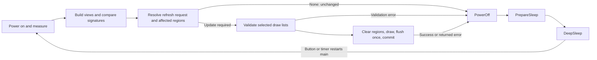

# Architecture

Paths are relative to `firmware/`.

`src/main.rs` initializes hardware and PSRAM, runs one wake cycle through `src/app.rs`,
logs any returned error after panel shutdown, then deep-sleeps through `src/hardware.rs`.
Each wake runs the same sequence:

| Layer | File | Responsibility |
|---|---|---|
| App | `src/app.rs` | Measure, build the default scene, refresh, and always shut down before returning |
| Scene | `src/badge.rs` | Six named builders produce independent views |
| UI pipeline | `src/ui/mod.rs` | View registry and the plan/validate/clear/draw/flush/commit transaction |
| Views | `src/ui/view.rs` | Elements, visual signatures, styles, bounds, and stable IDs |
| Renderer | `src/ui/render.rs` | Validate and draw elements against the target's bounds |
| Refresh | `src/ui/refresh.rs` | Diff snapshots, expand affected regions, and check retained records |
| Font | `src/ui/font.rs` | Decode the pre-rendered glyphs and draw text |
| Hardware | `src/hardware.rs` | Panel, ADC, button, RTC memory; debounce the button, configure wake sources, deep-sleep |

The view registry, refresh requests, and update guarantees are documented at the top of
`src/ui/mod.rs`. The default scene is built by `badge::frame(&badge, &layout, volts)?`, which
rejects information row spacing smaller than the text height. The returned pipeline borrows
the content buffers, so the `BadgeConfig` wrapper can be local to a factory function.
Other scenes can start with `Pipeline::new()` and register any views under any IDs.

| View ID | Content |
|---|---|
| `badge::LOGO` (0) | ASCII art |
| `badge::HEADLINE` (1) | `user@host` and underline |
| `badge::DATA` (2) | Ordered key/value rows (fits nine rows of roughly 32 characters including `Key: `) |
| `badge::BATTERY` (3) | Battery label, percentage, and voltage |
| `badge::BONUS` (4) | QR code and caption |
| `badge::COLOUR_SCALE` (5) | Grayscale blocks |

Only integer display records survive deep sleep; views are rebuilt on every wake.
Even unchanged readings require a short panel power-on to sample the battery (the battery
must be read after the panel rail is on); boot, PSRAM, and framebuffer allocation overhead
also remain. Actual energy savings require measurement. Battery percentage is a clamped
linear estimate between the voltage limits in `config.rs`.
